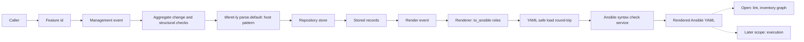

# Core Domain Distillation - Tiferet Ansible

**Status:** Draft (pre-implementation) - **Domain:** `tiferet-ansible` - **Code:** none yet - **Branch:** `docs-core-domain` (planned)
**Companion:** `docs/domain-vision.md`

> Pre-implementation note: the tiferet-ansible repository holds only a README, a license and a .gitignore. Every behavior below is the PLANNED shape, not existing code. Tiferet citations point at greatstrength/tiferet main at 4896542, as the patterns this domain follows. tiferet-ly citations point at greatstrength/tiferet-ly v1.x-proto at 254c4b6, the line being adapted to tiferet 2.2; ly main (1.0.4) is not 2.2-adapted. No paths in the target repo are cited, because none exist.

## 1. Purpose of this document

The vision statement says what Tiferet Ansible is for: keeping inventory, host config and playbooks as checked records and rendering Ansible YAML from them. This document says how it is meant to work: its vocabulary, its bounded steps, the rules between its parts, and the seams where the design bends.

As a single-domain repository, the whole package is one core domain. Read this before writing the first RFP, or before judging whether a feature belongs here, in tiferet core, in tiferet-ly, or in a later execution layer. Sections 5, 6 and 8 describe the intended shape and its risks, grounded in tiferet and tiferet-ly. When code lands, cite it and record drift.

## 2. The core domain, restated precisely

Tiferet Ansible's core domain is **keeping an organization's Ansible inventory, host config and playbooks as Tiferet records that are the single source of truth, and compiling them one way into the Ansible YAML that Ansible reads**.

Three rules shape everything else. First, inventory, host config and playbooks are domain objects. Second, Ansible YAML is output, rendered from those objects at runtime, never edited by hand and never parsed back into records. Third, this part of the application is a compiler: it checks that what it is given is well formed (syntax, grammar and record structure) and never checks records against a live inventory or real hosts. Parsing, grammar and syntax safety go through tiferet-ly, Tiferet's language package, wherever ly can carry them.

The domain has one fixed shape:

> **Change** -> **check** -> **store** -> **render** -> **check**

The workflow is: add and edit records freely, then render to seal the deal. Each named change (add a host, set its connection, add a task) is checked for syntax and structure and saved; saved changes accumulate in the stored records and touch no Ansible file. Rendering is the separate, deliberate step that writes the current records into Ansible files in the output project folder, syntax checked before success is reported.

It has three axes of variation:

1. **Inventory source** - where hosts and groups come from: hand-managed static records first; other sources (cloud plugins, scripts, a one-time import) remain open.
2. **Host-config shape** - what it takes to reach a host. Fields differ by connection type: SSH needs an address, port, user and perhaps a jump or bastion host; local needs almost nothing; WinRM and containers have their own settings.
3. **Playbook structure** - how much of Ansible's playbook language a record models: from one play with a flat task list to several plays with roles, pre- and post-tasks, handlers, nested blocks and imported playbooks. The task schema is open for extension, so this axis can grow without new record types.

Everything else is meant to be identical across the axes. Ansible structure the records do not model is carried through to the rendered file unchanged, not rejected.

## 3. Ubiquitous language

**Domain object** - a pydantic model holding validated, read-only state (`tiferet/domain/core.py:218`).

**Aggregate** - the mutable counterpart of a domain object, the only form a change is applied to (`tiferet/mappers/core.py:17`).

**Config object** - the transfer form of a domain object for reading and writing YAML, with named serialization roles applied in `to_primitive` (`TransferObject`, `tiferet/mappers/core.py:95`; `tiferet/mappers/core.py:120`).

**Record** - the vision statement's plain word for a domain object owned by this domain, changed through its aggregate and stored through its config object.

**Role** - a named set of serialization options on a config object, such as `to_model` and `to_data` (`tiferet/mappers/error.py:114`). A `to_ansible` render role is the planned way to produce Ansible-shaped output.

**Inventory** - the record for one set of hosts and groups a playbook can be rendered against. The implicit groups `all` and `ungrouped` are derived, not stored.

**Host group** - a named collection of host records inside an inventory, with child groups and group variables. Membership lives on the group, as in Ansible. Inventories and host groups are the host collections this domain manages.

**Host** - a host record: one machine as described to Ansible, identified by its inventory hostname, with its variables and host config. A host record is not a running host; a running host is its own service, outside this package.

**Host config** - how a host is reached: connection type, address, port, user, jump or bastion host, privilege escalation and other connection variables. Also called **routing**; the two words mean the same thing. The planned record is `HostConnection`, rendered to Ansible's `ansible_*` host variables.

**Playbook** - the record for one playbook file: an ordered list of plays plus any imported playbooks, and optionally the output directory it renders into.

**Play** - one entry in a playbook: a host pattern, play-level settings and variables, roles and task sections.

**Task** - one step in a play: a module name, its arguments and its keywords (conditions, loops, notifications, tags). A **handler** is a task that runs only when notified. Common keywords are typed fields; the schema is open for extension.

**Block** - a task that groups other tasks, with optional rescue and always sections; blocks can nest.

**Role reference** - a play's reference to an Ansible role by name, not resolved against installed roles.

**Host pattern** - the string in a play's `hosts` field (for example `web:&prod`) naming hosts and groups in a small pattern syntax. Only its syntax is checked here; which hosts it selects is Ansible's business at run time.

**Compiler** - this domain's stance toward its input: it checks syntax, grammar and record structure, never meaning against the outside world (live inventories, real hosts, installed roles).

**Syntax check** - the required check that a record is well formed before it is stored, and that rendered output is well-formed YAML and well-formed Ansible before it is handed on. It never contacts a host.

**tiferet-ly** - Tiferet's language package, a PLY lex/yacc wrapper in which a small language is declared as configuration and read through declared `lex` and `parse` features.

**Token rule**, **production rule**, **grammar** - the tiferet-ly domain objects that declare a language: `TokenRule` (`tiferet_ly/domain/token.py:14`), `ProductionRule` (`tiferet_ly/domain/production.py:14`) and `Grammar` (`tiferet_ly/domain/grammar.py:18`), stored in ly's `configs/tokens.yml`, `configs/productions.yml` and `configs/grammars.yml`.

**Render** - the one-way step, a workflow separate from saving records, that turns stored records into Ansible YAML files. **Rendered output** is what it produces: output only, never a source. It is written into a persistent **output project** folder.

**Service** - an abstract contract an event depends on (`tiferet/interfaces/core.py:136`). A **repository** is a service that stores records in configuration YAML (`tiferet/repos/core.py:21`).

**Event** - one single-purpose operation (`tiferet/events/core.py:17`). A **feature** is a declared, ordered list of event steps (`tiferet/domain/feature.py:301`), run by its `<domain>.<verb>` **feature id**, such as `error.add` (`tiferet/assets/feature.py:59`).

**Catalogued error** - a named domain failure resolved to a message, raised as `TiferetError` (`tiferet/assets/core.py:596`). Distinct from a **service error**, an infrastructure failure raised as `ServiceError` (`tiferet/interfaces/core.py:15`).

## 4. What the domain reads / operates on

The domain operates on four inputs.

**Change requests**: a feature id plus its data, from a CLI, a script or another program, each naming one operation on one record. It is the only way state changes.

**Stored records**: the inventories, host groups, host records, host configs, playbooks, plays and tasks already accepted. They are stored in Tiferet configuration YAML keyed by id, as `errors:` is keyed in tiferet core (`tiferet/repos/error.py:70`), which is not Ansible format.

**Render requests**: a request to produce the Ansible files for a playbook or an inventory. Output goes to the output project folder; a playbook record can name its own output directory, and a request may override it.

**Declared grammars**: tiferet-ly token, production and grammar declarations, in ly's config form, for the small languages this domain checks. The first is host pattern syntax; a native template-expression grammar is a later candidate. They are planned, not written. Rendered YAML and whole playbooks are not ly inputs (5.6).

Three tiferet conventions give the domain its leverage. The id is the YAML key and is left out of the stored body (`'exclude': {'id'}` at `tiferet/mappers/error.py:116`). Ordered children (plays, tasks) are managed by position, as feature steps are with `add_step`, `remove_step` and `reorder_step` (`tiferet/mappers/feature.py (164-254)`). Secrets are referenced, not held, through `$env.` resolution in `parse_parameter` (`tiferet/blueprints/core.py:475`).

## 5. The behaviors

### 5.1 Inventory and host-group management

*Create, read, list, update and remove inventories and their host groups.*

Planned events (AddInventory, AddHostGroup, SetGroupVar, AddGroupChild and their get, list, update and remove counterparts) sit under a per-module base event, behind an inventory service. This mirrors the error module: `ErrorEvent` (`tiferet/events/error.py:20`) and its events (`tiferet/events/error.py (41-293)`) over `ErrorService` (`tiferet/interfaces/error.py:16`). Checks are limited to well-formedness: required fields present, values of the right type, names in the form Ansible accepts. Questions of meaning, such as whether a group would end up containing itself through its children, are not validation checks here.

Verdict: **variable** on axis 1 (sources change where groups come from, not the operations).

### 5.2 Host and host-config management

*Create, read, list, update and remove host records, set their host config, and assign them to groups.*

Planned events: AddHost, SetHostConnection, SetHostVar, AssignHostToGroup and their counterparts. Host records are managed as part of inventory management, behind the inventory service; there is no separate host service. Nothing here starts, stops or probes a running host. Host config checks are structural (a known connection type, an integer port, the fields a connection type requires), using pydantic validators on the record as `Error` does with a `model_validator` (`tiferet/domain/error.py (67-70)`), with changes through aggregate methods as in `ErrorAggregate.set_message` (`tiferet/mappers/error.py:44`). Errors include HOST_NOT_FOUND and INVALID_HOST_CONNECTION.

Verdict: **variable** on axis 2. Required fields depend on the connection type.

### 5.3 Playbook, play and task management

*Create, read, list, update and remove playbooks, and add, update, reorder and remove their plays, tasks, handlers and role references.*

Planned events (AddPlaybook, AddPlay, AddTask, ReorderTask, AddRoleRef and their counterparts) sit behind a playbook service. Task operations target a section (tasks, pre-tasks, post-tasks, handlers) and a position, copying AddFeatureStep through ReorderFeatureStep (`tiferet/events/feature.py (268-499)`) and ids such as `feature.reorder_step` (`tiferet/assets/feature.py:98`). Errors include PLAYBOOK_NOT_FOUND, PLAY_NOT_FOUND and TASK_NOT_FOUND. A task stores its module name and arguments separately, and the schema is open for extension: further keywords can be carried on the record. Keywords the domain does not model pass unchanged into rendered output.

Verdict: **variable** on axis 3.

### 5.4 Host-pattern syntax check

*Check that a play's host pattern is well formed.*

A host pattern (names joined by `:`, `&` and `!`) gets its own small tiferet-ly grammar, declared in ly's config form and read through ly's `parse.default` feature (`configs/feature.yml:17`), whose reading step is `ParseText` (`tiferet_ly/events/parse.py:18`) over `PlyParser` (`tiferet_ly/utils/parse.py:31`). A pattern that does not parse is rejected when the change is made, with a catalogued error such as HOST_PATTERN_INVALID. A pattern that parses always renders: there is no check against a live inventory or real hosts, and an unmatched pattern never blocks. The grammar is planned, not written.

Verdict: **agnostic**; pattern syntax does not vary by axis.

### 5.5 Render

*Turn stored records into Ansible inventory, host and group variable files, and playbook files, one way.*

Rendering commits saved changes to Ansible files; until it runs, the output project folder holds the previous render. Planned RenderInventory (`inventory.render`) and RenderPlaybook (`playbook.render`) events load records through a service and pass them to a pure renderer in the utils layer; rendering inside repositories is rejected because it mixes storage and output formats. The renderer builds Ansible-shaped data through a `to_ansible` role (`tiferet/mappers/core.py:120`) and writes it with `YamlLoader.save` (`tiferet/utils/yaml.py:1075`). Host config renders to `ansible_*` variables; a task's module and arguments are rejoined as `<module>: {args}`. Template expressions are written verbatim and never evaluated. Unmodeled structure passes through unchanged. Rendering is deterministic: identical records give byte-identical files. Vault values stay opaque, written as references and never decrypted. Files are written into the persistent output project folder (or the playbook's own output directory) and kept; there is no temporary folder or cleanup. Where an inventory's files land within the project is open. Laying output out for execution tooling is later execution scope, not a render concern. Success is reported only after the syntax check (5.6) passes.

Verdict: **agnostic** in pipeline, **variable** in content on axes 2 and 3.

### 5.6 Syntax check

*Check that records are well formed before they are stored, and that rendered output is well-formed YAML and Ansible before it is handed on.*

Syntax checking is required on every change and every render, for language safety. It runs in layers, each owned by the tool that understands it:
- Records: pydantic validation of structure before storage.
- Embedded small languages: host patterns through their ly grammar (5.4). Template expressions inside `{{ }}` and `` are parsed by the existing jinja2 parser behind a service interface, never evaluated; a native ly grammar may come later (section 10).
- Rendered YAML: not a ly job. Each rendered file must load back through a YAML safe load as a round-trip check. The loaded result never becomes a record.
- Ansible syntax: ly cannot check it natively. A service interface in this package shells out to `ansible-playbook --syntax-check` for playbooks and `ansible-inventory --list` for inventories.

ValidatePlaybook (`playbook.validate`) runs it without handing files on. Failures map to catalogued errors such as PLAYBOOK_SYNTAX_INVALID and INVENTORY_SYNTAX_INVALID; a missing Ansible binary is a `ServiceError` (`tiferet/interfaces/core.py:15`). Unit tests stub the Ansible service; one integration test runs the real binaries. No check contacts a host.

Because the check is required, Ansible must be present wherever rendering runs; whether as a declared dependency, an optional extra or a system prerequisite is open. `ansible-inventory --graph` and lint are open and not part of the required check.

Verdict: **agnostic** in pipeline, **variable** in coverage: what grammars and structural checks must cover grows with axis 3.

## 6. How the behaviors compose

Each behavior is a feature: a feature id mapped to events, as tiferet core maps `error.add` (`tiferet/assets/feature.py:59`). Saving and rendering are separate workflows: callers save as many changes as they like, then render once to write them out. A management feature runs change, check and store in one call; for a play, the host-pattern check runs inside it. A render feature runs load, render into the output project, the YAML safe-load check and the Ansible syntax check, and reports success only when all pass. Lint and inventory graph, if adopted, would be separate features.

Dotted edges are open or later; no edge leads back from rendered output to records.

## 7. Relationships / cross-boundary rules

Host groups belong to one inventory; host records belong to one inventory and any number of its groups, with membership on the group. Variables are stored as given; Ansible applies precedence at run time.

A play refers to an inventory only through its host pattern, by name, never by object reference, so one playbook can be rendered against a test or a production inventory. This domain never judges whether `web:&prod` selects anything; selection is Ansible's job at run time. Role references and module names are likewise names only.

Toward tiferet-ly: it declares a language as token rules, production rules and grammars, managed by events such as `AddToken` (`tiferet_ly/events/token.py:79`), `AddProduction` (`tiferet_ly/events/production.py:190`) and `AddGrammar` (`tiferet_ly/events/grammar.py:152`), and reads text through the `lex.default` and `parse.default` features (`configs/feature.yml:2`, `configs/feature.yml:17`), backed by `LexText` (`tiferet_ly/events/lex.py:18`) over `PlyLexer` (`tiferet_ly/utils/lex.py:20`) and by the parse path in 5.4, on PLY (`pyproject.toml:11`). Ly ships no host pattern, template or Ansible grammar; this domain declares its own.

Toward tiferet core: this domain adds records, services, events and errors, and relies on core for the rest. It is tested with Python unit tests, not tiferet's YAML-based tests. Toward later execution: the output project is the hand-off; execution tooling reads it and never writes records.

## 8. The agnostic core and the variable edge

Built once:
- The change, check, store pipeline for every record type (`tiferet/repos/error.py:19` pattern) and ordered-child management for plays and tasks.
- The render pipeline and the layered syntax check.
- The error catalog, its split from service errors, and `$env.` secret references.

Varies per case:
- Inventory source (axis 1); host-config fields per connection type (axis 2); modeled playbook structure and the grammar coverage that follows (axis 3).
- Render layout: inline variables versus host and group variable files.

Entanglement inventory (risks in the planned shape):
- `ConfigurationRepository` sets `default_role = 'to_data'` for every repository (`tiferet/repos/core.py:54`), so a render role must be named explicitly at each render call. Folding render into repositories would make storage and output share that default, which is why it is rejected (5.5).
- The id-excluded-from-body convention (`tiferet/mappers/error.py:116`) fits stored records, and Ansible inventory output is also keyed by name, tempting one config object to serve both; storage and render roles should stay separate.
- Mapping host config one to one onto `ansible_*` variables can leak Ansible naming into the domain vocabulary as connection types grow (axis 2).
- The open task schema and unchanged pass-through carry structure that record checks cannot see; only the post-render Ansible check covers it.
- tiferet-ly's PLY parser reports a syntax failure as a `ServiceError` with code PARSE_ERROR (`tiferet_ly/utils/parse.py:80`, catalogued at `configs/error.yml:12`). In tiferet core a `ServiceError` means infrastructure failure (`tiferet/interfaces/core.py:15`), but here an unparsable host pattern is a domain outcome. The boundary must translate it into this domain's catalogued error; where is undecided.
- The ly line is a moving target: its `tiferet>=2.2.0,<2.3` pin (`pyproject.toml:9`) is on v1.x-proto at 254c4b6, heading for v1.1.0b1. Open ly work (PR #139, PR #140, issue #130) can move layout behavior and event or domain names before the tag, so ly citations here may shift.
- The Ansible check shells out, putting a process boundary and an install requirement inside an otherwise pure step; hence its service interface.
- `YamlLoader.save` (`tiferet/utils/yaml.py:1075`) uses pyyaml. Deterministic output depends on its ordering behavior, not yet verified for this render.

## 9. Boundaries

Inside the domain: the inventory, host and playbook records and their operations; the required syntax check, with its grammars and service interfaces; the one-way render.

Outside the domain:
- Running playbooks: later scope; whether in this package or a separate execution layer, and its owner, is undecided.
- Services management (the repository tagline): later scope.
- Running hosts: their own service.
- Checking records against a live inventory or real hosts: not done anywhere in this domain.
- Language machinery, each behind an interface: lex/yacc and the grammar engine (tiferet-ly, on PLY), template expression parsing (jinja2 for now), YAML parsing (a safe load) and Ansible syntax judgment (`ansible-playbook --syntax-check`, `ansible-inventory --list`).
- Connecting to hosts, running modules, variable precedence and template evaluation: Ansible.
- Feature execution, dependency wiring, configuration loading and error catalog machinery: tiferet core.
- Importing existing Ansible files into records: outside the one-way design.

## 10. Where this leads

Candidate changes, each scoped for its own RFP or TRD:

1. Inventory records (inventories, host groups, host records, host config) with their events, feature ids and errors, all behind the inventory service.
2. Playbook, play, task, handler and role-reference records with their events and an open-for-extension task schema.
3. Repositories storing the records in Tiferet config YAML keyed by id. pyyaml versus ruamel.yaml for comment preservation is open.
4. The one-way render workflow and `to_ansible` roles: deterministic output, opaque vault values, unchanged pass-through of unmodeled structure, and a persistent output project folder with a per-playbook output directory.
5. The host pattern grammar in tiferet-ly config form, read through `parse.default`, and translation of ly parse failures into catalogued errors.
6. Template-expression checks through the existing jinja2 parser behind a service interface.
7. The required post-render check: YAML safe-load round-trip, then an Ansible syntax service shelling out to `ansible-playbook --syntax-check` and `ansible-inventory --list`, stubbed in unit tests with one integration test on the real binaries. Ansible packaging, inventory graph and lint are open.
8. The tiferet-ly dependency: pin a v1.x-proto commit SHA through a git URL, never ly main, and re-pin deliberately at the v1.1.0b1 tag. The tiferet target follows that line (`tiferet>=2.2.0,<2.3` today). Tests are Python unit tests.
9. Future: a native tiferet-ly grammar for template expressions, replacing or backing the jinja2 parser.
10. Later scope: playbook execution and services management.
